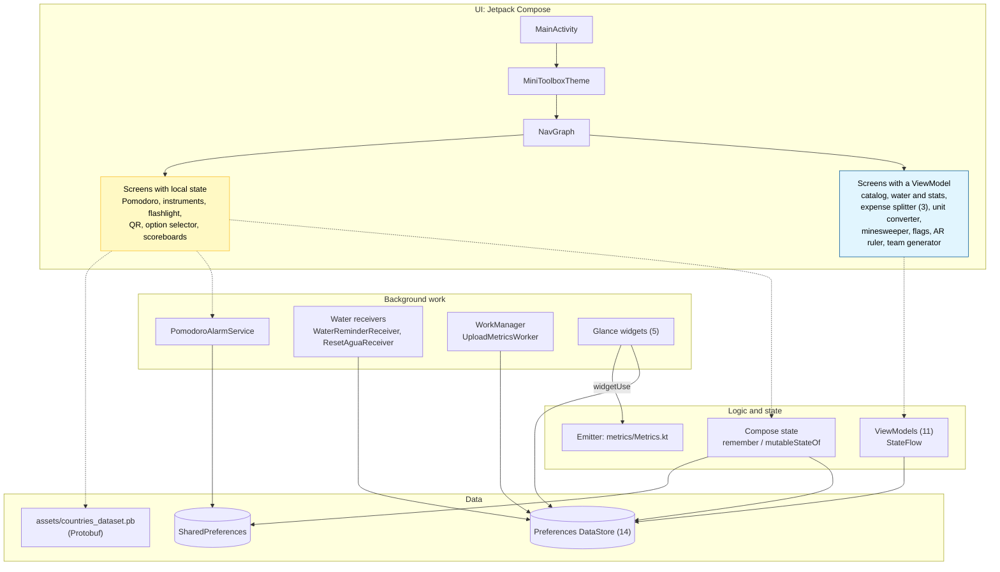
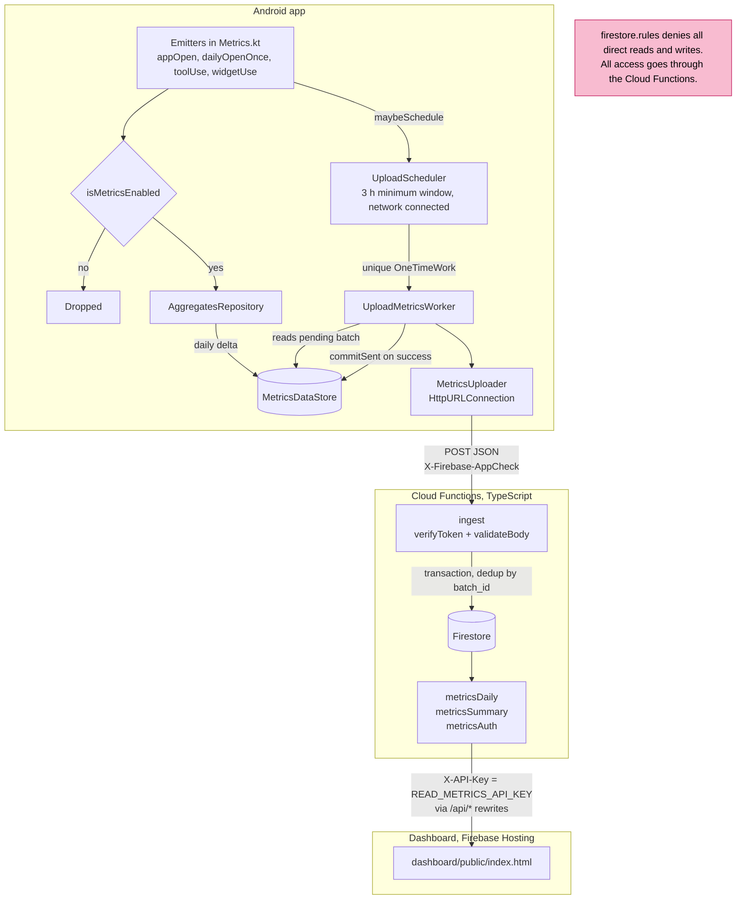
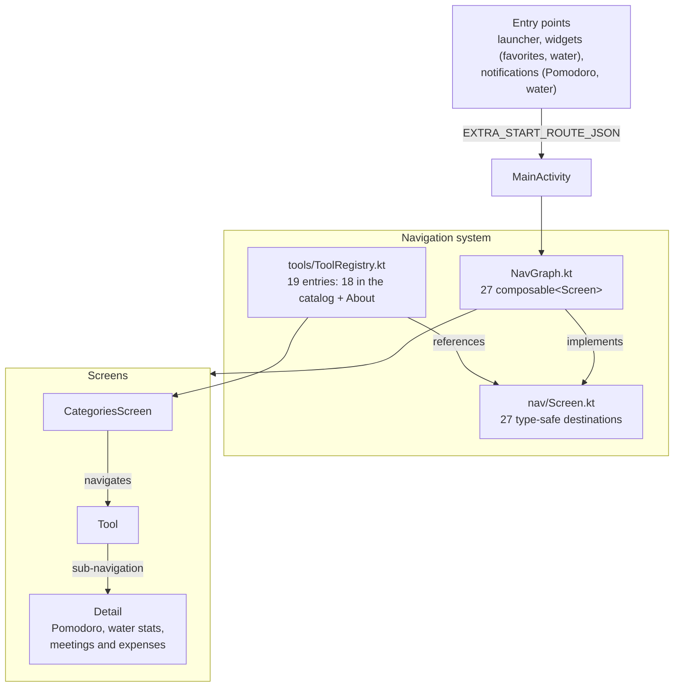
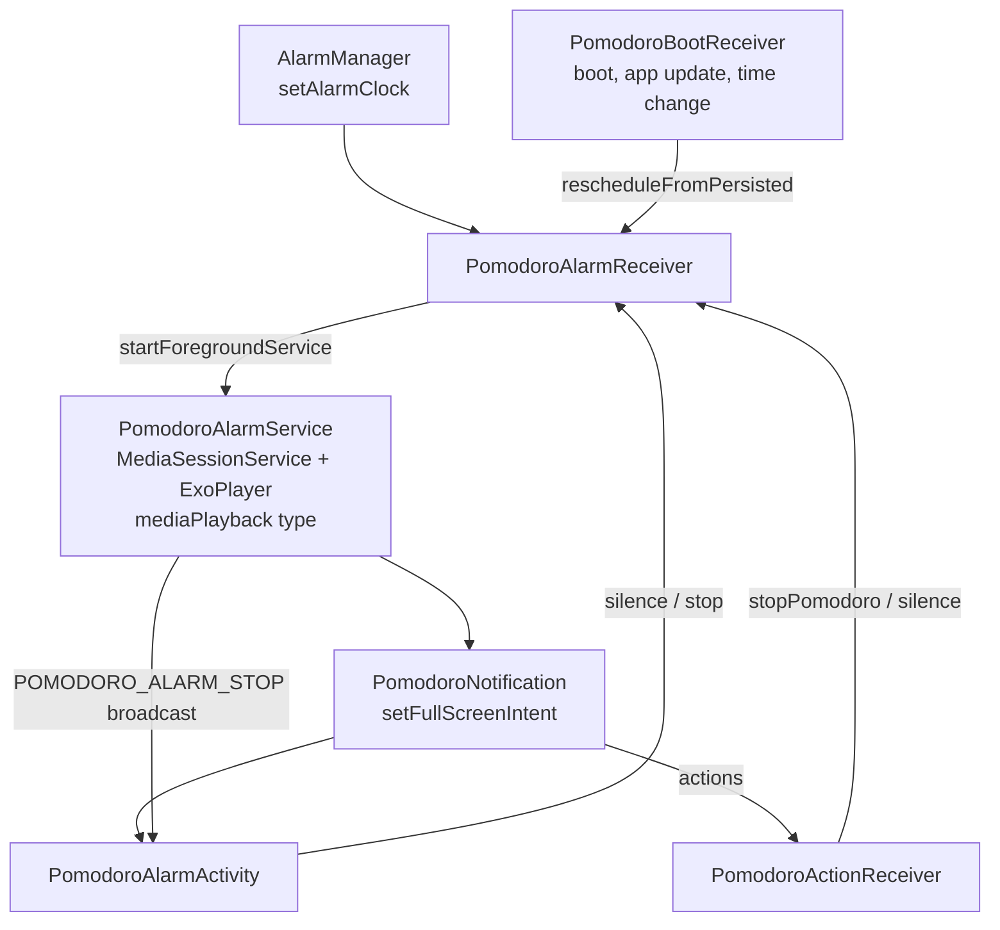

# MiniToolbox architecture

[Español](architecture.md)

This document describes the system's actual architecture, including its asymmetries and limitations. Every box and arrow in the diagrams maps to existing code; the counts can be reproduced with the commands in section 8.

**Last verified:** November 10, 2026
**Verified code:** `master @ f299165` (any commits after that hash touch documentation only)

The constraints that do not change without an ADR are in [DECISIONS.md](../DECISIONS.md) (Spanish).

---

## 1. Overview

A single Gradle module (`:app`), by explicit decision. `MainActivity` hosts the theme and the `NavGraph`; each tool is a navigation destination.

### Diagram A: layers and state

Two state strategies coexist. New or refactored screens use a `ViewModel`; older ones keep their state inside the Composable and are migrated when touched.



---

## 2. Telemetry

Collects usage without device, user or session identifiers. The device only sends daily counters. The meaning of each counter is in [metrics-glossary.en.md](metrics-glossary.en.md).

### Diagram B: end-to-end pipeline



**Firestore collections** (`backend/functions/src/index.ts`):

| Collection | Contents |
|---|---|
| `metrics_daily/{month}/days/{day}` | Daily aggregates, incremented with `FieldValue.increment` |
| `metrics_ingest_batches/{batch_id}` | Processed-batch marker; if it exists, the transaction does not add again |
| `metrics_auth/{month}` | Monthly rollup of accepted batches and pipeline health ([ADR](decisions/appcheck-only-ingest.md), Spanish) |
| `metrics_ingest_logs` | Per-batch log |

**Authentication.** Ingest accepts App Check tokens only (Play Integrity in release, the debug provider in debug). Reads accept `READ_METRICS_API_KEY` only.

**Known asymmetry.** The dashboard requests `metricsAuth` at `/api/metricsAuth`, but `dashboard/firebase.json` only has rewrites for `metricsSummary`, `metricsDaily` and `ingest`. When served from Hosting, that path falls into the `**` rewrite and returns `index.html`. It is tracked in the backlog (`dashboard-metricsauth-rewrite`).

---

## 3. Navigation and catalog

The technical route (`Screen`) is kept apart from the catalog entry (`Tool` in `ToolRegistry`). Each tool's metrics key is `Tool.metricsKey`, which defaults to the route (DECISIONS §4).

### Diagram C: navigation flow



- `About` is listed in `ToolRegistry` only to keep its metrics key; it does not appear in the catalog.
- `DevMetrics` is an internal diagnostics screen with no catalog entry.
- There are no launcher shortcuts (`ShortcutManagerCompat`): `MetricsSource.SHORTCUT` exists but is never emitted.
- Cold start with a destination: `MainActivity` resolves `EXTRA_START_ROUTE_JSON` before `setContent`, and `prepareStartBackStack` (`NavGraph.kt`) builds the `[Categories, destination]` back stack before `NavHost` first composes. The catalog is never composed and there is no transition. If the Activity already exists, the destination arrives through `onNewIntent` and is navigated to with the animation. See `docs/arranque-en-frio-postmortem.md` (Spanish).

---

## 4. Pomodoro alarm

Android restricts exact alarms and background audio, so the alarm goes through a foreground service. The diagnosis is written up in [pomodoro-background-alarm-fix.md](pomodoro-background-alarm-fix.md) and [pomodoro-alarma-postmortem.md](pomodoro-alarma-postmortem.md) (both in Spanish).



The alarm state lives in SharedPreferences (`AlarmState`, `PomodoroSchedulePrefs`), not in DataStore. The timer phase is in DataStore (`PomodoroStateRepository`).

---

## 5. Package structure

```
app/src/main/java/com/joasasso/minitoolbox/
├── MainActivity.kt, NavGraph.kt, CategoriesScreen.kt, AboutScreen.kt
├── data/            # Per-tool DataStores and repositories
├── dev/             # Metrics inspector and diagnostics (DevMetrics)
├── metrics/         # Emitters, key contract, retention
│   ├── storage/     # AggregatesRepository, MetricsDataStore, sanitizer
│   └── uploader/    # UploadScheduler, UploadMetricsWorker, MetricsUploader
├── nav/             # Screen (type-safe destinations)
├── tools/           # Tool, ToolCategory, ToolRegistry
│   ├── entretenimiento/
│   │   ├── aleatorio/      # Option selector
│   │   └── minijuegos/     # Flags (ViewModel and FlagQuiz); minesweeper/ with engine and ViewModel
│   ├── herramientas/
│   │   ├── calculadoras/   # Unit converter (engine, parser, ViewModel)
│   │   ├── generadores/    # QR, team generator
│   │   └── instrumentos/   # Compass, level, light, flashlight, magnifier, ruler; arruler/
│   └── organizacion/
│       ├── divisorGastos/  # DebtEngine and 3 ViewModels
│       ├── pomodoro/       # Screens, receivers, alarm service and activity
│       └── recordatorios/agua/
├── ui/              # components/, theme/, utils/
├── utils/           # Application, search, navigation
├── viewmodel/       # Only CategoryViewModel; the rest live next to their tool
└── widgets/         # Glance widgets
```

Package names are in Spanish. The catalog categories (Measure, Essentials, Organize, Generate, Play) do not match the packages, which keep the older grouping. To locate a tool, use `ToolRegistry`, not the package tree.

---

## 6. Persistence

**11 `preferencesDataStore` instances.** Ten are in `data/` and one in `metrics/storage/MetricsDataStore.kt`, kept apart on purpose because it belongs to telemetry.

- `PomodoroDataStore.kt` declares two: `pomodoro_state` and `pomodoro_settings`. The second is a leftover and must not be used in new code.

**SharedPreferences** is used where a synchronous read is needed or for historical reasons:

- Pomodoro: `AlarmState`, `PomodoroSchedulePrefs` and part of `PomodoroDataStore.kt`.
- Telemetry: the metrics switch and the `dailyOpenOnce` marker (`Metrics.kt`), and the last scheduling time (`UploadScheduler`).
- `ScoreboardDataStore.kt`, despite its name.

**Orphan files on updated devices.** Removing the PRO mode left files that nothing reads (`orphan-monetization-storage` backlog item).

**Countries dataset.** `assets/countries_dataset.pb`, read with full `protobuf-java`. The migration to Lite is in a [pending ADR](decisions/protobuf-lite-migration.md) (Spanish).

---

## 7. Known limitations

1. **State in Composables.** Several tools keep their logic in `remember`/`mutableStateOf` without a ViewModel, and that logic has no unit tests.
2. **No dependency injection.** Tests swap dependencies through `@VisibleForTesting` hooks (`metricsRepoFactory` in `Metrics.kt`). Backlog item `dependency-injection`.
3. **Ad hoc scopes.** Some `CoroutineScope(...)` instances are created outside `viewModelScope`, and the `appScope` in `MiniToolboxApp` is private. Backlog item `app-scope`.
4. **Debug traffic in production.** Debug builds send to the same endpoint and the payload does not say which build sent it. Backlog item `debug-traffic-in-prod`.
5. **Single module.** This is a decision (DECISIONS §1), not debt: it is revisited through an ADR if the project's size calls for it.

---

## 8. How to verify this document

A mismatch between the code and this document is a documentation bug. The counts above are reproduced as follows:

| Figure | Command | Value |
|---|---|---|
| DataStores | `git grep "by preferencesDataStore" -- app/src/main/java \| wc -l` | 11 |
| Destinations in `Screen` | `grep -c "@SerialName" app/src/main/java/com/joasasso/minitoolbox/nav/Screen.kt` | 27 |
| Destinations in the `NavGraph` | `grep -c "composable<" app/src/main/java/com/joasasso/minitoolbox/NavGraph.kt` | 27 |
| `ToolRegistry` entries | `grep -c "Tool(" app/src/main/java/com/joasasso/minitoolbox/tools/ToolRegistry.kt` | 19 |
| ViewModels | `git ls-files "app/src/main/*ViewModel.kt" \| wc -l` | 11 |
| Glance widgets | `git grep -l "GlanceAppWidget()" -- app/src/main/java \| wc -l` | 5 |

A possible improvement is turning this table into a test that fails when a count changes, so the document cannot drift silently.
