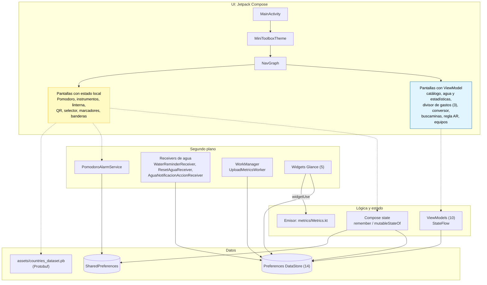
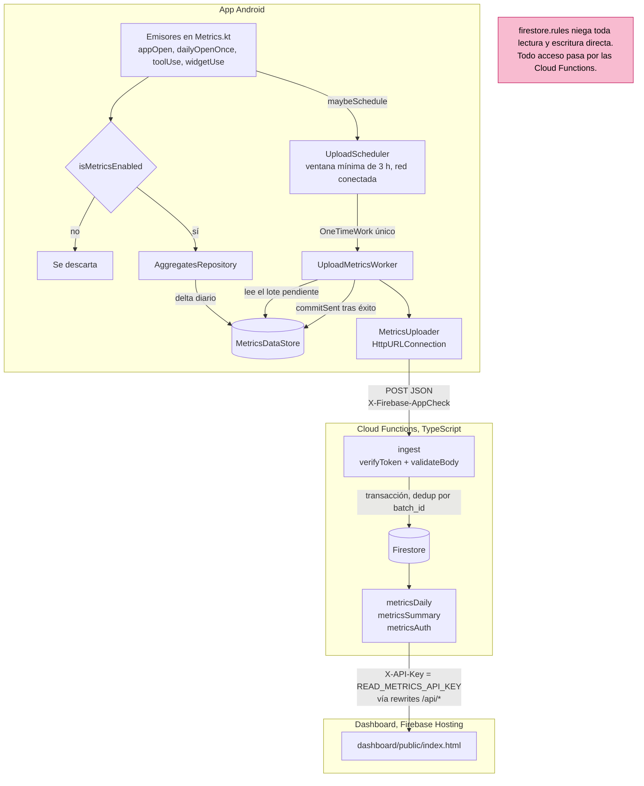
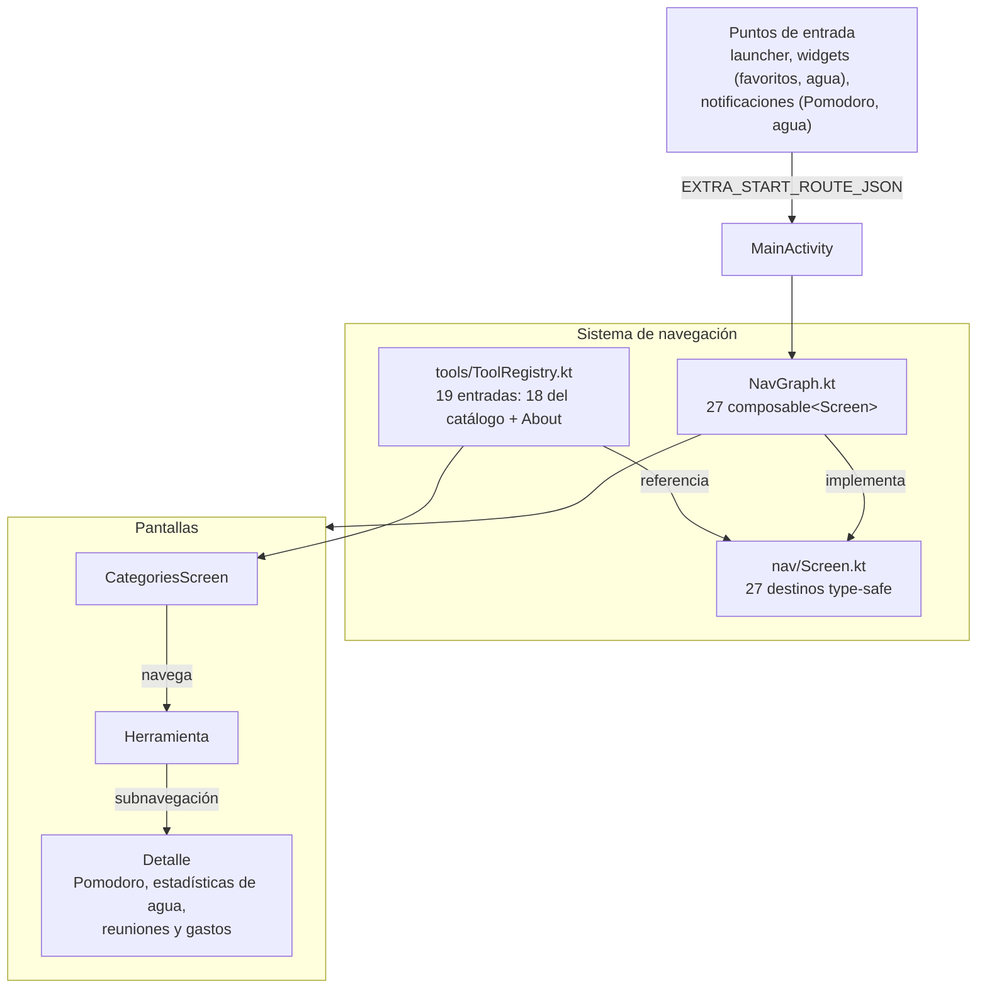
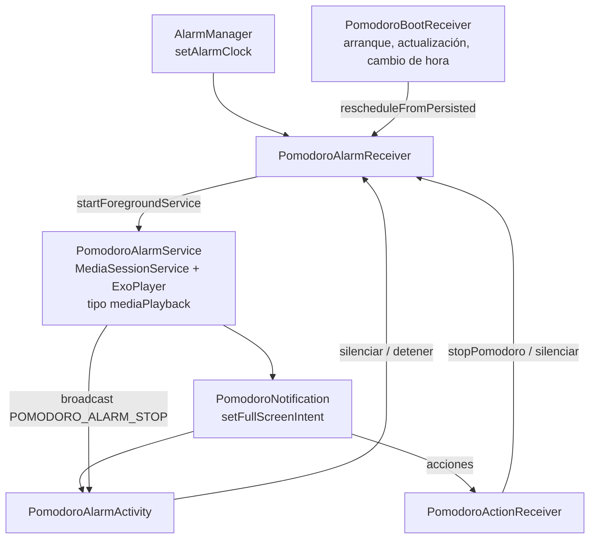

# Arquitectura de MiniToolbox

[English](architecture.en.md)

Describe la arquitectura real del sistema, incluidas sus asimetrías y limitaciones. Cada caja y cada flecha de los diagramas corresponde a código existente; los conteos se reproducen con los comandos de la sección 8.

**Última verificación:** 10 de noviembre de 2026
**Código verificado:** `master @ f299165` (los commits posteriores a ese hash, si los hay, solo tocan documentación)

Las restricciones que no se cambian sin un ADR están en [DECISIONS.md](../DECISIONS.md).

---

## 1. Vista general

Un solo módulo de Gradle (`:app`), por decisión explícita. `MainActivity` aloja el tema y el `NavGraph`; cada herramienta es un destino de navegación.

### Diagrama A: capas y estado

Conviven dos estrategias de estado. Las pantallas nuevas o refactorizadas usan `ViewModel`; las más viejas guardan el estado en el Composable y se migran cuando se las toca.



---

## 2. Telemetría

Recolecta uso sin identificadores de dispositivo, de usuario ni de sesión. El dispositivo solo envía contadores diarios. La semántica de cada contador está en [metrics-glossary.md](metrics-glossary.md).

### Diagrama B: pipeline de punta a punta



**Colecciones de Firestore** (`backend/functions/src/index.ts`):

| Colección | Contenido |
|---|---|
| `metrics_daily/{mes}/days/{día}` | Agregados diarios, incrementados con `FieldValue.increment` |
| `metrics_ingest_batches/{batch_id}` | Marca de lote procesado; si existe, la transacción no vuelve a sumar |
| `metrics_auth/{mes}` | Rollup mensual de lotes aceptados y salud del pipeline ([ADR](decisions/appcheck-only-ingest.md)) |
| `metrics_ingest_logs` | Registro por lote |

**Autenticación.** La ingesta acepta solo tokens de App Check (Play Integrity en release, proveedor de debug en debug). La lectura acepta solo `READ_METRICS_API_KEY`.

**Asimetría conocida.** El dashboard pide `metricsAuth` en `/api/metricsAuth`, pero `dashboard/firebase.json` solo tiene rewrites para `metricsSummary`, `metricsDaily` e `ingest`. Servido desde Hosting, esa ruta cae en el rewrite `**` y devuelve `index.html`. Está anotado en el backlog (`dashboard-metricsauth-rewrite`).

---

## 3. Navegación y catálogo

La ruta técnica (`Screen`) está separada de la ficha visual del catálogo (`Tool` en `ToolRegistry`). La clave de métricas de cada herramienta es `Tool.metricsKey`, que por defecto coincide con la ruta (DECISIONS §4).

### Diagrama C: flujo de navegación



- `About` figura en `ToolRegistry` solo para conservar su clave de métricas; no aparece en el catálogo.
- `DevMetrics` es una pantalla de diagnóstico interna, sin entrada en el catálogo.
- No hay accesos directos de launcher (`ShortcutManagerCompat`): `MetricsSource.SHORTCUT` existe pero nunca se emite.
- Arranque en frío con destino: `MainActivity` resuelve `EXTRA_START_ROUTE_JSON` antes de `setContent` y `prepareStartBackStack` (`NavGraph.kt`) arma la pila `[Categories, destino]` antes de la primera composición de `NavHost`. El catálogo no se compone y no hay animación. Con la Activity ya creada, el destino llega por `onNewIntent` y se navega con animación. Ver `docs/arranque-en-frio-postmortem.md`.

---

## 4. Alarma del Pomodoro

Android restringe las alarmas exactas y el audio en segundo plano, así que la alarma pasa por un foreground service. El proceso de diagnóstico está en [pomodoro-background-alarm-fix.md](pomodoro-background-alarm-fix.md) y en [pomodoro-alarma-postmortem.md](pomodoro-alarma-postmortem.md).



El estado de la alarma vive en SharedPreferences (`AlarmState`, `PomodoroSchedulePrefs`), no en DataStore. La fase del temporizador sí está en DataStore (`PomodoroStateRepository`).

---

## 5. Estructura de paquetes

```
app/src/main/java/com/joasasso/minitoolbox/
├── MainActivity.kt, NavGraph.kt, CategoriesScreen.kt, AboutScreen.kt
├── data/            # DataStores y repositorios por herramienta
├── dev/             # Inspector y diagnóstico de métricas (DevMetrics)
├── metrics/         # Emisores, contrato de claves, retención
│   ├── storage/     # AggregatesRepository, MetricsDataStore, sanitizer
│   └── uploader/    # UploadScheduler, UploadMetricsWorker, MetricsUploader
├── nav/             # Screen (destinos type-safe)
├── tools/           # Tool, ToolCategory, ToolRegistry
│   ├── entretenimiento/
│   │   ├── aleatorio/      # Selector de opciones
│   │   └── minijuegos/     # Banderas; minesweeper/ con motor y ViewModel
│   ├── herramientas/
│   │   ├── calculadoras/   # Conversor de unidades (motor, parser, ViewModel)
│   │   ├── generadores/    # QR, generador de equipos
│   │   └── instrumentos/   # Brújula, nivel, luz, linterna, lupa, regla; arruler/
│   └── organizacion/
│       ├── divisorGastos/  # DebtEngine y 3 ViewModels
│       ├── pomodoro/       # Pantallas, receivers, servicio y actividad de alarma
│       └── recordatorios/agua/
├── ui/              # components/, theme/, utils/
├── utils/           # Application, búsqueda, navegación
├── viewmodel/       # Solo CategoryViewModel; el resto vive junto a su herramienta
└── widgets/         # Widgets Glance
```

Las categorías del catálogo (Medir, Esenciales, Organizar, Generar, Jugar) no coinciden con los paquetes, que conservan la clasificación anterior. Para ubicar una herramienta, la referencia es `ToolRegistry`, no el árbol de paquetes.

---

## 6. Persistencia

**14 instancias de `preferencesDataStore`.** Trece están en `data/` y una en `metrics/storage/MetricsDataStore.kt`, aislada a propósito por pertenecer a la telemetría.

- `PomodoroDataStore.kt` declara dos: `pomodoro_state` y `pomodoro_settings`. La segunda es un remanente y no debe usarse en código nuevo.
- Tres no tienen referencias: `BMIDataStore.kt`, `EventsDataStore.kt` y `vCardDataStore.kt`. Están en el ítem `dead-code` del backlog.

**SharedPreferences** se usa donde hace falta lectura síncrona o por herencia:

- Pomodoro: `AlarmState`, `PomodoroSchedulePrefs` y parte de `PomodoroDataStore.kt`.
- Telemetría: el interruptor de métricas y la marca de `dailyOpenOnce` (`Metrics.kt`), y la última programación (`UploadScheduler`).
- `ScoreboardDataStore.kt`, pese al nombre.
- `RachasDataStore.kt`, sin uso.

**Archivos huérfanos en dispositivos que actualizan.** Al quitar el modo PRO quedaron archivos que nadie lee (ítem `orphan-monetization-storage` del backlog).

**Dataset de países.** `assets/countries_dataset.pb`, leído con `protobuf-java` completo. La migración a Lite está en un [ADR pendiente](decisions/protobuf-lite-migration.md).

---

## 7. Limitaciones conocidas

1. **Estado en Composables.** Varias herramientas guardan su lógica con `remember`/`mutableStateOf`, sin ViewModel, y esa lógica no tiene tests unitarios.
2. **Sin inyección de dependencias.** Los tests reemplazan dependencias con hooks `@VisibleForTesting` (`metricsRepoFactory` en `Metrics.kt`). Ítem `dependency-injection` del backlog.
3. **Scopes ad hoc.** Hay `CoroutineScope(...)` creados fuera de `viewModelScope`, y el `appScope` de `MiniToolboxApp` es privado. Ítem `app-scope`.
4. **Tráfico debug en producción.** Las builds debug envían al mismo endpoint y el payload no dice qué build lo envió. Ítem `debug-traffic-in-prod`.
5. **Módulo único.** Es una decisión (DECISIONS §1), no una deuda: se revisa con un ADR si el tamaño del proyecto lo justifica.

---

## 8. Cómo verificar este documento

Una discrepancia entre el código y este documento es un bug de documentación. Los conteos citados se reproducen así:

| Dato | Comando | Valor |
|---|---|---|
| DataStores | `git grep "by preferencesDataStore" -- app/src/main/java \| wc -l` | 14 |
| Destinos en `Screen` | `grep -c "@SerialName" app/src/main/java/com/joasasso/minitoolbox/nav/Screen.kt` | 27 |
| Destinos en el `NavGraph` | `grep -c "composable<" app/src/main/java/com/joasasso/minitoolbox/NavGraph.kt` | 27 |
| Entradas de `ToolRegistry` | `grep -c "Tool(" app/src/main/java/com/joasasso/minitoolbox/tools/ToolRegistry.kt` | 19 |
| ViewModels | `git ls-files "app/src/main/*ViewModel.kt" \| wc -l` | 10 |
| Widgets Glance | `git grep -l "GlanceAppWidget()" -- app/src/main/java \| wc -l` | 5 |

Una mejora posible es convertir esta tabla en un test que falle cuando un conteo cambie, para que el documento no se desactualice en silencio.
